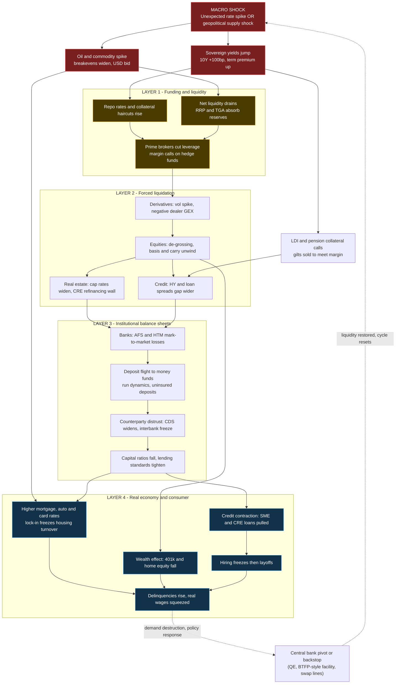

# Market Trends — System Blueprint

> All dashboard values in this repo are simulated. Thresholds are rules of thumb to be backtested, not guarantees.

## 1. Metric engine: Top 15 indicators

| # | Indicator | Source | Early-warning trigger (warn / crit) | Historical relevance |
|---|-----------|--------|-------------------------------------|----------------------|
| 1 | 10Y–2Y spread | FRED `T10Y2Y` | <25bp / <0 (inverted); also +50bp re-steepening in 3m from negative | Inverted 2006 → GFC; Aug 2019 → 2020; 2022–24 deep inversion |
| 2 | 10Y–3M spread | FRED `T10Y3M` | <50bp / <0 on 3m average | Inverted before every US recession since the 1960s |
| 3 | Fed Net Liquidity YoY (WALCL − RRP − TGA) | FRED `WALCL`,`RRPONTSYD`,`WTREGEN` | <0% / <−5% | 2022 drain; Mar-2020 and Mar-2023 injections |
| 4 | Global M2 YoY | FRED `M2SL`, BIS, central banks | <3% / <0% | 2020 surge → 2021 boom; 2022 contraction → drawdown |
| 5 | HY OAS | FRED `BAMLH0A0HYM2` | >450bp / >600bp, or +100bp in 30d | 2008 >2,000bp; 2020 ~1,100bp; 2022 ~600bp |
| 6 | Bank 5Y CDS | Bloomberg/ICE; proxy KRE vs XLF | >100bp / >175bp | Lehman 2008; SVB/Credit Suisse 2023 |
| 7 | HY default rate / implied PD vs IG | Moody's, S&P; proxy HYG–LQD | >4% / >7%; rising HY:IG PD ratio | 2009 13%; 2016 energy; 2020 |
| 8 | DXY 3m momentum | Yahoo `DX-Y.NYB` | >+4% / >+8% | 2008, 2014–15, 2022 dollar squeezes |
| 9 | Copper/Gold 6m change | Yahoo `HG=F`,`GC=F` | <−5% / <−12% | Led yields lower in 2008, 2011, 2019 |
| 10 | Brent 3m change | Yahoo `BZ=F`, FRED `DCOILBRENTEU` | >+20% / >+40% | 1973, 1990, 2008, 2022 |
| 11 | 10Y breakeven / 5y5y | FRED `T10YIE`,`T5YIFR` | >250bp / >300bp (5y5y >2.75%) | 2008 deflation collapse; 2022 de-anchoring scare |
| 12 | VIX (+ term structure) | FRED `VIXCLS` | >22 / >30; VIX>VIX3M | 2008 80; 2020 82; 2022 36 |
| 13 | MOVE | Yahoo `^MOVE` | >110 / >140 | 2008; Mar-2020 164; Mar-2023 199 |
| 14 | CBOE SKEW | Yahoo `^SKEW` | >140 / >155 | Complacency signal; record readings 1990, 2021 |
| 15 | Dealer net GEX | SqueezeMetrics, CBOE OI | <0 / <−$5bn | Volmageddon 2018; Mar-2020; Aug-2024 carry unwind |

SEC EDGAR use: parse 10-K/10-Q for bank AFS/HTM unrealized losses and uninsured-deposit share (tag `AvailableForSaleSecuritiesDebtSecurities`, etc.), and 13F for positioning. Stress score per indicator = `(v − safe)/(crit − safe)` where `safe = 2·warn − crit` (0.5 at warn, 1.0 at crit). Composite = mean score, with an override to "Systemic stress" at ≥4 reds.

## 2. Cascading impact matrix
Source of truth: [`cascade.mmd`](cascade.mmd) (rendered live on the site).

## 3. Going live (replace simulated data)
Browsers cannot call FRED directly (CORS, API key). Use a scheduled GitHub Action that fetches data server-side and commits `data/latest.json`, then have `data.js` load it:
1. Add repo secret `FRED_API_KEY`.
2. Cron workflow (`0 22 * * 1-5`) runs a Python script using `requests` against `https://api.stlouisfed.org/fred/series/observations` and `yfinance`, writes JSON, commits.
3. In `radar.js`, `fetch('data/latest.json')` and overwrite `INDICATORS[i].value` before `initRadar()`.
GEX/CDS need paid vendors; leave as manual or vendor-API inputs.

## 4. Stress model caveat
`BETA` in `assets/js/modules/stress.js` are stylized elasticities. Calibrate by regressing monthly SPY/KBW/VNQ returns on ΔCPI, Δpolicy rate, Δoil, ΔHY OAS (e.g. 1990–today, with crisis dummies) and replace the values.
