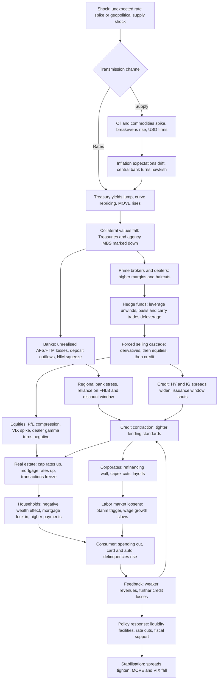

# Systemic triggers and transmission channels (Pillar 2)

> View the rendered diagram on GitHub: https://github.com/Jackpison/Market-Trends/blob/main/docs/05-transmission-channels.md

## Cascade after a major shock (rate spike or geopolitical supply shock)

## 1. The liquidity cascade
1. **Central bank to banks.** Policy-rate moves change funding costs and the value of bank securities. Balance-sheet changes (QE/QT) change reserves; **net liquidity** (balance sheet minus reverse repo minus Treasury General Account) shows what actually reaches markets.
2. **Banks to prime brokers and dealers.** Dealers fund inventories in repo markets. When collateral values fall or volatility rises, haircuts and margins rise.
3. **Prime brokers to hedge funds.** Higher margin means less leverage. Crowded, leveraged strategies (basis trades, carry trades) must shrink at the same time.
4. **To retail.** Margin-account liquidations, outflows from funds, and tighter credit reach households last, usually after prices have already moved.

## 2. Asset-class contagion (forced liquidation order)
- **Derivatives first**: margin calls and option hedging flows move fastest.
- **Liquid equities and Treasuries** are sold to raise cash even when they are not the problem ("sell what you can, not what you want").
- **Credit** follows: dealers cannot warehouse bonds, spreads gap wider, new issuance stops.
- **Real estate and private assets** reprice last and slowest (appraisals, cap rates), but are where leverage is often largest.

## 3. Institutional counterparty risk
- **Bank run mechanics**: unrealised losses plus uninsured deposits plus fast digital withdrawals can overwhelm liquidity before solvency is tested (SVB, March 2023).
- **Collateral and margin spirals**: falling prices raise margin calls, forcing more selling.
- **Leverage unwinds**: examples include the UK LDI crisis (Sept 2022, pension funds forced to sell gilts to meet collateral calls) and the yen carry-trade unwind (Aug 2024).
- **Common thread**: a shock to the *safe* asset (government bonds) is the most dangerous because that asset is the system's collateral.

## What to watch in this dashboard
| Stage | Indicators |
|---|---|
| Trigger | 10Y-2Y/3M spreads, breakevens, oil, dollar |
| Funding stress | Net liquidity, MOVE, financial stress index |
| Forced selling | VIX, KRE drawdown, HY and IG OAS |
| Real-economy spillover | Sahm rule, M2 growth |
